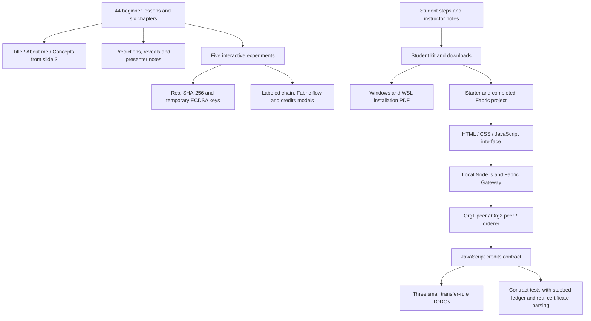

# Workshop architecture

The website's models do not claim to execute Fabric. The separate project uses real Fabric APIs and confirms transfers after valid commit. A full live-network rehearsal remains outstanding until Docker Desktop and Ubuntu integration are running. Earlier Solidity examples and recordings are retained outside the active workshop and are not Fabric evidence.
